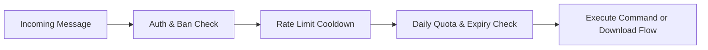

# Telegram High-Speed Media Downloader Bot

A production-grade Telegram Media Downloader Bot written in **Go (Golang)** using **gotgbot**, **yt-dlp**, **FFmpeg**, and **SQLite**. It features raw link auto-detection (YouTube, Instagram, TikTok, Twitter/X), an anti-rate-limit progress bar, licensing system with crypto keys, and administrative tools.

---

## 🛠️ Tech Stack (Strictly Locked)

- **Language:** Go (Golang 1.23+)
- **Telegram Framework:** [`gotgbot/v2`](https://github.com/PaulSonOfLars/gotgbot)
- **Engine:** `yt-dlp`
- **Transcoder:** `FFmpeg`
- **Database:** SQLite (`modernc.org/sqlite` pure-Go driver, CGO-free)

---

## 📂 Project Structure (14 Internal Files + Entrypoint)

```
I:\ClipGo\
├── main.go                       # Bot entrypoint & signal orchestrator
├── go.mod                        # Go module configuration
├── Dockerfile                    # Multi-stage Alpine container build
├── docker-compose.yml            # Docker deployment with volumes
├── .env                          # Production environment variables (credentials)
├── .env.example                  # Environment configuration template
├── README.md                     # Documentation
├── data/                         # SQLite database storage (bot.db)
├── downloads/                    # Temporary video & thumbnail buffer
└── internal/
    ├── config/
    │   └── config.go             # (1) Environment & configuration parser
    ├── db/
    │   ├── db.go                 # (2) SQLite connection & 3-table schema setup
    │   ├── licenses.go           # (3) License queries & CRUD operations
    │   ├── users.go              # (4) User queries, expirations & quota resets
    │   └── downloads.go          # (5) Download metrics & logging queries
    ├── license/
    │   └── license.go            # (6) Crypto/rand keygen & redemption lifecycle
    ├── downloader/
    │   ├── platforms.go          # (7) Platform regex recognition (YT, IG, TT, X)
    │   ├── progress.go           # (8) Anti-rate-limit checkpoint progress bar
    │   └── downloader.go         # (9) yt-dlp execution, semaphore & cancel
    └── bot/
        ├── bot.go                # (10) Engine, dispatcher, route setup & polling
        ├── middleware.go         # (11) Auth -> Rate limit -> Quota check pipeline
        ├── user_handlers.go      # (12) 8 User commands & 13-step raw link flow
        ├── admin_handlers.go     # (13) 10 Admin commands & ring buffer logging
        ├── jobs.go               # (14) 3 Background jobs (expiry, clean, quota)
        └── errors.go             # (15) 12 Pre-written consistent error strings
```

---

## 🗄️ Database Schema (3 Exact Tables)

### 1. `licenses` Table
```sql
CREATE TABLE IF NOT EXISTS licenses (
    id INTEGER PRIMARY KEY AUTOINCREMENT,
    key TEXT UNIQUE NOT NULL,
    plan TEXT NOT NULL,
    duration_days INTEGER NOT NULL,
    max_activations INTEGER DEFAULT 1,
    activation_count INTEGER DEFAULT 0,
    created_at DATETIME DEFAULT CURRENT_TIMESTAMP,
    expires_at DATETIME,
    status TEXT DEFAULT 'active'
);
```

### 2. `users` Table
```sql
CREATE TABLE IF NOT EXISTS users (
    telegram_id INTEGER PRIMARY KEY,
    username TEXT,
    license_key TEXT,
    plan TEXT DEFAULT 'free',
    status TEXT DEFAULT 'active',
    daily_quota INTEGER DEFAULT 5,
    daily_downloads INTEGER DEFAULT 0,
    last_download_at DATETIME,
    quota_reset_at DATETIME,
    registered_at DATETIME DEFAULT CURRENT_TIMESTAMP,
    expires_at DATETIME,
    FOREIGN KEY(license_key) REFERENCES licenses(key)
);
```

### 3. `downloads` Table
```sql
CREATE TABLE IF NOT EXISTS downloads (
    id INTEGER PRIMARY KEY AUTOINCREMENT,
    telegram_id INTEGER NOT NULL,
    url TEXT NOT NULL,
    platform TEXT NOT NULL,
    title TEXT,
    file_size INTEGER,
    duration INTEGER,
    status TEXT NOT NULL,
    error_message TEXT,
    created_at DATETIME DEFAULT CURRENT_TIMESTAMP,
    FOREIGN KEY(telegram_id) REFERENCES users(telegram_id)
);
```

---

## 🔑 License System

- **Format:** `crypto/rand` uppercase alphanumeric format: `PREM-XXXX-XXXX-XXXX`
- **Lifecycle:** `active` → `redeemed` (when activations reach limit) → `expired` → `revoked`
- **Plans & Durations:**
  - `trial`: 1 day (15 downloads/day)
  - `daily`: 1 day (30 downloads/day)
  - `weekly`: 7 days (60 downloads/day)
  - `monthly`: 30 days (120 downloads/day)
  - `lifetime`: 36,500 days / permanent (Unlimited downloads)
  - `free`: default fallback (5 downloads/day)
- **Binding Rules:**
  - Bound to user's Telegram ID upon redemption.
  - If user already holds an active paid plan, redeeming another extends the existing `expires_at` date.
  - Automatically demotes to `free` when expiration date passes.

---

## 👤 User Commands

| Command | Description |
|---|---|
| `/start` | Welcomes user, registers profile in SQLite, displays quick-start guide |
| `/help` | Complete instruction guide, rules, and supported formats |
| `/status` | Shows personal plan, group VIP plan (in groups), quota, and expiry |
| `/redeem <key>` | Redeems a license key, upgrades plan, and extends validity |
| `/activategroup <key>` | Activates VIP downloads and high quota for an entire group chat |
| `/plans` | Interactive menu with buttons to buy plans & notify owner instantly |
| `/stats` | Personal metrics: total downloads, data transferred, favorite platform |
| `/ping` | Server health, API roundtrip latency, and uptime |
| `/cancel` | Instantly aborts any ongoing download task for the user |

---

## 🔗 Raw Link Detection (No `/download` Needed)

Users simply paste links directly into chat or group. Built-in regex matches:
- **YouTube:** Videos, Shorts, Live, Embeds (`youtube.com/watch?v=`, `youtu.be/`, `youtube.com/shorts/`)
- **Instagram:** Reels, Posts, Stories, TV (`instagram.com/p/`, `instagram.com/reel/`)
- **TikTok:** Videos, Shorts (`tiktok.com/@user/video/`, `vm.tiktok.com/`)
- **Twitter / X:** Video tweets (`twitter.com/*/status/`, `x.com/*/status/`)

---

## ⚡ 13-Step Download Pipeline

1. **Detection:** Catch message text matching platform regexes.
2. **Auth:** Ensure user exists; block if banned.
3. **Plan & Quota Check:** Verify group VIP quota (if in group) or personal quota.
4. **Concurrency Check:** Prevent user duplicate downloads (`sync.Map`).
5. **Semaphore Acquisition:** Acquire slot in global concurrency buffer (`chan struct{}`).
6. **User Cancellation Context:** Register cancellation hook for `/cancel`.
7. **Initial Notification:** Send "🔍 Analyzing link..." status message.
8. **Metadata Query:** Fast metadata probe (`yt-dlp --dump-single-json`).
9. **Constraint Validation:** Check duration and maximum allowable file size.
10. **Stream Download:** Execute `yt-dlp` with real-time stdout progress.
11. **Anti-Flood Checkpoint Updates:** Throttled progress message updates.
12. **Telegram Upload:** Transmit MP4 via `bot.SendVideo` with title, platform, duration, and thumbnail.
13. **Cleanup & Logging:** Remove local temp files, insert record in SQLite `downloads`, increment user or group quota.

---

## 🛡️ Admin Commands (Usable in DM or Groups)

| Command | Syntax & Example | Output Example |
|---|---|---|
| `/genkey` | `/genkey monthly 30 3` | `✅ Generated 3 key(s) for plan 'monthly' (30 days)` |
| `/revokekey` | `/revokekey PREM-XXXX-XXXX-XXXX` | `✅ License key 'PREM-XXXX' has been revoked.` |
| `/listkeys` | `/listkeys [active\|redeemed\|all]` | Lists recent 15 keys with activation counts and status |
| `/ban` | `/ban 123456789 [reason]`, `/ban @username`, or reply with `/ban` | `⛔ User 123456789 (@username) has been banned.` |
| `/unban` | `/unban 123456789`, `/unban @username`, or reply with `/unban` | `✅ User 123456789 has been unbanned.` |
| `/user` | `/user 123456789`, `/user @username`, or reply with `/user` | Full user card: ID, username, plan, quota, total downloads |
| `/setquota` | `/setquota 123456789 50` | `✅ Daily quota for user 123456789 updated to 50.` |
| `/broadcast` | `/broadcast Server maintenance at 02:00` | Broadcasts message to all active users with live progress |
| `/stats_admin` | `/stats_admin` | System analytics: total users, active VIPs, memory, uptime |
| `/logs` | `/logs [20]` | Prints last N execution entries from in-memory ring buffer |

---

## 🚦 Middleware Pipeline



---

## ⏰ 3 Background Jobs

1. **Expiry Checker (Every 10 min):** Scans expired VIP subscriptions, demotes users to Free tier, and notifies them.
2. **Temp Cleanup (Every 30 min):** Sweeps `downloads/` directory and removes orphaned files older than 1 hour.
3. **Quota Reset (Every 1 min):** Checks if UTC date has changed, resetting `daily_downloads = 0` for all users.

---

## 📊 Anti-Rate-Limit Progress Checkpoint Logic

Telegram heavily rate-limits message edits. To prevent `429 Too Many Requests`:
- Updates trigger **only if**:
  - Download percentage advances by $\ge 10\%$ **OR**
  - Time elapsed since last Telegram edit is $\ge 2.5\text{ seconds}$ AND percentage has changed.
- Progress bar renders:
  ```
  ⬇️ Downloading media...
  [██████░░░░] 60.0%
  ⚡ Speed: 4.8 MB/s
  ⏳ ETA: 00:12
  ```

---

## ⚠️ 12 Pre-Written Error Strings

1. `ERR_INVALID_URL`: `"❌ Invalid or unsupported URL. Please send a valid link from YouTube, Instagram, TikTok, or Twitter/X."`
2. `ERR_RATE_LIMITED`: `"⏳ Slow down! You are sending requests too quickly. Please wait a few seconds."`
3. `ERR_QUOTA_EXCEEDED`: `"⚠️ You have reached your daily download limit. Upgrade your plan or redeem a license key with /redeem."`
4. `ERR_DOWNLOAD_FAILED`: `"❌ Failed to download media. The content might be private, deleted, or geo-restricted."`
5. `ERR_FILE_TOO_LARGE`: `"📁 File exceeds Telegram's upload size limit (50 MB). Try downloading a shorter clip."`
6. `ERR_UNAUTHORIZED`: `"🚫 You are not authorized to use this bot or command."`
7. `ERR_BANNED`: `"⛔ Your account has been suspended from using this service."`
8. `ERR_INVALID_KEY`: `"🔑 Invalid or non-existent license key. Please check and try again."`
9. `ERR_KEY_EXPIRED`: `"⏰ This license key has expired or has already been redeemed."`
10. `ERR_ALREADY_DOWNLOADING`: `"🔄 You already have an active download in progress. Use /cancel to abort it."`
11. `ERR_CANCELLED`: `"🛑 Download process was cancelled."`
12. `ERR_INTERNAL_SERVER`: `"💥 An internal server error occurred while processing your request. Please try again later."`

---

## 🔒 Security Design

- **Shell Injection Prevention:** All system commands execute via `exec.CommandContext(ctx, binary, args...)` with isolated argument slices. No shell (`sh -c` or `cmd.exe`) is invoked.
- **Cryptographic Keys:** Keys are generated via `crypto/rand` using an unambiguous character set (`23456789ABCDEFGHJKLMNPQRSTUVWXYZ`).
- **Concurrency Limitation:** Global downloads are constrained by a channel semaphore (`chan struct{}`), preventing system resource exhaustion.

---

## 🚀 Deployment Instructions

### Option 1: Docker Compose (Recommended)

1. Configure `.env`:
   ```bash
   cp .env.example .env
   # Edit .env with your BOT_TOKEN and ADMIN_IDS
   ```
2. Build and launch:
   ```bash
   docker compose up -d --build
   ```
3. Inspect logs:
   ```bash
   docker compose logs -f
   ```

### Option 2: Native Go Run

1. Ensure `yt-dlp` and `ffmpeg` are on system `PATH`.
2. Configure `.env` file.
3. Run:
   ```bash
   go run main.go
   ```
